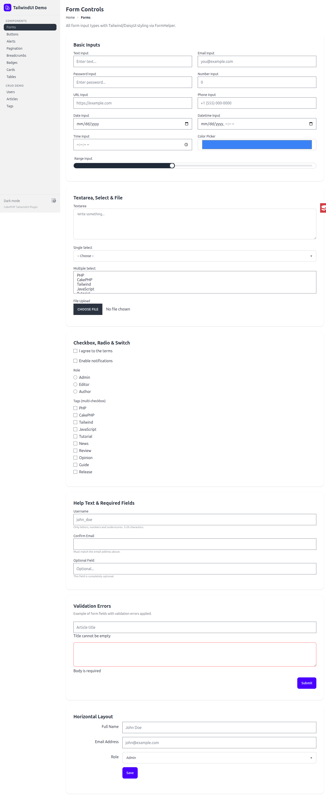
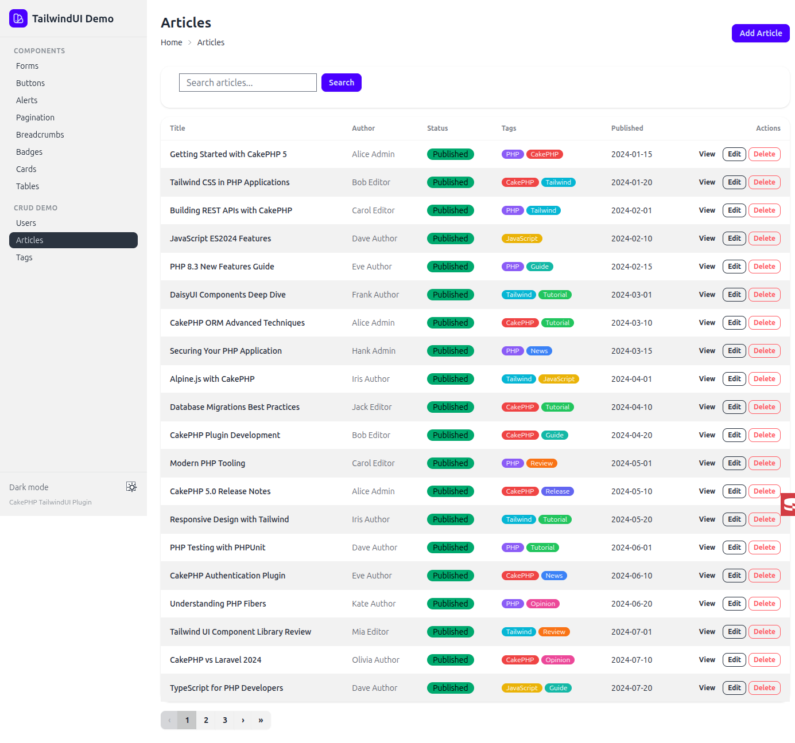
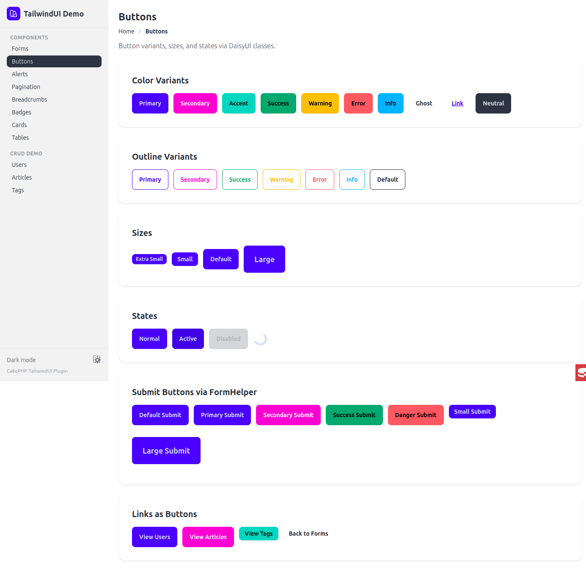
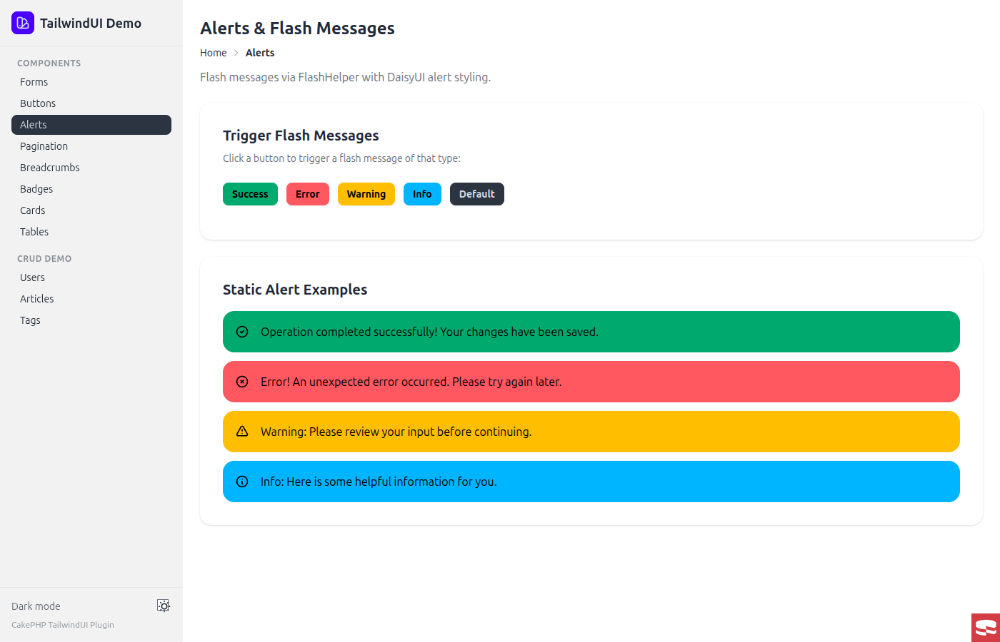

# CakePHP TailwindUi Plugin

Tailwind CSS and DaisyUI view helpers for CakePHP forms, pagination, flash messages, and navigation.

Read the [documentation website](https://dereuromark.github.io/cakephp-tailwind-ui/), starting with [Installation](https://dereuromark.github.io/cakephp-tailwind-ui/installation) and [Getting started](https://dereuromark.github.io/cakephp-tailwind-ui/guide/getting-started).

## Preview

`$this->Form->control()`, `$this->Paginator->links()`, `$this->Flash->render()`, and `$this->Html->badge()` rendered with the default DaisyUI preset:

| | |
|---|---|
|  |  |
|  |  |

See the [screenshot gallery](https://dereuromark.github.io/cakephp-tailwind-ui/screenshots) for both presets.

## Helpers

| Helper | Description |
|--------|-------------|
| **FormHelper** | Text, select, checkbox, radio, switch, textarea, file, range, input groups, horizontal layout |
| **PaginatorHelper** | `links()` method with join/flex container |
| **FlashHelper** | Alert rendering with icons |
| **BreadcrumbsHelper** | Breadcrumb navigation |
| **HtmlHelper** | `badge()`, `alert()`, and `icon()` methods |

## Class Map Presets

| Preset | Framework | Usage |
|--------|-----------|-------|
| `daisyui` (default) | [DaisyUI](https://daisyui.com) | No config needed |
| `ktui` | [KTUI](https://ktui.io/docs) | `Configure::write('TailwindUi.classMap', 'ktui')` |

Keep custom presets in your application and pass their returned array to `TailwindUi.classMap`; see the [preset guide](https://dereuromark.github.io/cakephp-tailwind-ui/presets#custom-preset).

## Documentation

- [Installation](https://dereuromark.github.io/cakephp-tailwind-ui/installation)
- [Getting started](https://dereuromark.github.io/cakephp-tailwind-ui/guide/getting-started)
- [Compile your CSS](https://dereuromark.github.io/cakephp-tailwind-ui/guide/css)
- [Helpers](https://dereuromark.github.io/cakephp-tailwind-ui/helpers)
- [Class maps and presets](https://dereuromark.github.io/cakephp-tailwind-ui/presets)
- [Screenshots](https://dereuromark.github.io/cakephp-tailwind-ui/screenshots)
